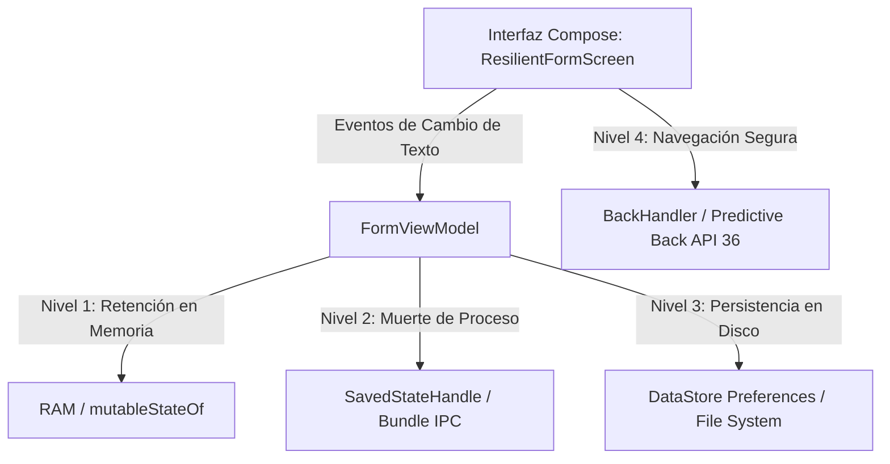

# INFORME DE LABORATORIO 2.2
## FORMULARIO DE REGISTRO ULTRA-RESILIENTE Y NAVEGACIÓN PREDICTIVA (API 36)

---

### DATOS INFORMATIVOS
* **Institución:** Universidad / Escuela Politécnica
* **Asignatura:** Redes Digitales y Aplicaciones Móviles 1 (RDA1)
* **Docente:** [Nombre del Docente]
* **Semestre / Nivel:** [Semestre/Año Académico]
* **Integrantes del Grupo:**
  1. Joan Santacruz
  2. Ariel Chacha
  3. Esteban Garcia
  4. Anthony Rosero
* **Nombre del Proyecto:** `RDA1_Lab7_ResilientForm_JoanSantacruz_ArielChacha_EstebanGarcia_AnthonyRosero`
* **Fecha de Entrega:** [Fecha de Entrega, Ej. 27 de Octubre de 2026]

---

## 1. CONTEXTO Y OBJETIVOS

### 1.1 Contexto
En el desarrollo móvil moderno y profesional para sistemas Android, la pérdida accidental de datos ingresados por el usuario debido a cambios de configuración (como la rotación de pantalla) o por la liberación agresiva de memoria por parte del sistema operativo (**Low Memory Killer - LMK**) resulta inadmisible y deteriora drásticamente la Experiencia de Usuario (UX). 

Con la evolución a **Android 16 (API 36)**, Google estandariza interfaces reactivas basadas en **Jetpack Compose**, la arquitectura **MVVM (Model-View-ViewModel)** y el sistema de **Predictive Back** (Navegación Predictiva por gestos). Este laboratorio aborda una estrategia de persistencia multinivel que garantiza que el estado de la aplicación sobreviva a cualquier evento del ciclo de vida.

### 1.2 Objetivos
* **Objetivo General:**
  * Desarrollar una interfaz de usuario móvil ultra-resiliente en Android 16 utilizando Jetpack Compose, asegurando la integridad y persistencia de datos ante cambios de configuración, muerte del proceso y terminación forzosa de la aplicación.
* **Objetivos Específicos:**
  * Implementar persistencia de estado multinivel:
    * **Capa Memoria:** Gestión reactiva mediante `ViewModel` y estados Compose.
    * **Capa Proceso:** Retención de datos frente a la destrucción por el LMK mediante `SavedStateHandle`.
    * **Capa Disco:** Almacenamiento no volátil y asíncrono con **Jetpack DataStore Preferences** a través de Kotlin Coroutines y Flow.
  * Configurar y validar el sistema nativo de **Predictive Back** (API 36) mediante `BackHandler` para evitar la salida involuntaria del usuario ante borradores incompletos.
  * Aplicar el patrón de diseño **Unidirectional Data Flow (UDF)** y *State Hoisting* en Jetpack Compose para desacoplar responsabilidades y optimizar la recomposición.
  * Incorporar un mecanismo de retroalimentación visual reactivo (desafío) que notifique al usuario la persistencia efectiva en disco.

---

## 2. REQUISITOS PREVIOS Y ENTORNO DE DESARROLLO

* **IDE:** Android Studio Ladybug (Feature Drop o superior).
* **Entorno de Ejecución:** Emulador Android Google Pixel 8 configurado con imagen de sistema **Android 16.0 (VanillaIceCream / API 36)**.
* **Opciones de Desarrollador Habilitadas:**
  * *Don't keep activities* (No mantener actividades) para pruebas de *Process Death*.
  * Animaciones de navegación predictiva activas.
* **Lenguaje y Stack:** Kotlin 2.x, Kotlin Coroutines (`Flow`, `suspend`, `viewModelScope`), Jetpack Compose (BOM reciente), Jetpack DataStore Preferences `1.1.1`.
* **JDK:** Java 21 LTS.

---

## 3. DESCRIPCIÓN GENERAL DEL SISTEMA

El sistema implementado consiste en una pantalla denominada **"Borrador de Perfil"**, que administra información sensible de registro del usuario (Nombre, Correo Electrónico y Switch de Notificaciones). Para optimizar los recursos del dispositivo y evitar sobrecargar el disco o la memoria RAM, se divide la persistencia en tres niveles estratégicos:



1. **Campo Nombre (Persistencia en Disco - DataStore):**
   * Persiste de forma indefinida, incluso si el proceso es destruido o la aplicación es cerrada por completo desde el menú de aplicaciones recientes (*Swipe Up*).
2. **Campo Email (Persistencia en Proceso - SavedStateHandle):**
   * Persiste ante cambios de configuración (rotación) y ante la muerte del proceso orquestada por el *Low Memory Killer* (LMK) cuando el sistema necesita recursos.
3. **Control Predictivo de Retroceso (Predictive Back):**
   * Si existen datos activos en el borrador de nombre, el sistema intercepta el gesto de retroceso del usuario registrando el evento en el Logcat y evitando descartar accidentalmente los datos.
4. **Desafío - Indicador de Guardado Reactivo:**
   * Al completarse la escritura en DataStore de manera asíncrona, se activa un microindicador visual (icono de nube sincronizada / check) visible durante 1 segundo.

---

## 4. CUADRO COMPARATIVO TÉCNICO DE PERSISTENCIA

| Criterio | Memoria RAM (`remember` / `ViewModel`) | Estado de Proceso (`SavedStateHandle`) | Almacenamiento Persistente (`DataStore Preferences`) |
| :--- | :--- | :--- | :--- |
| **Ubicación Física** | Memoria RAM volátil del proceso | Almacenamiento temporal del sistema operativo (OS Bundle / Binder) | Disco de almacenamiento no volátil flash (archivo PB / XML en sandbox) |
| **Sobrevive a Rotación** | Sí (`ViewModel`), No (`remember` simple) | Sí | Sí |
| **Sobrevive a Muerte de Proceso (LMK)** | **No** (La memoria RAM del proceso es liberada) | **Sí** (El SO restaura el Bundle al recrear la actividad) | **Sí** |
| **Sobrevive a Cierre Forzado / Swipe Up** | **No** | **No** (El registro de navegación es destruido) | **Sí** (Permanece en el sistema de archivos del app sandbox) |
| **Sobrevive a Reinicio del Dispositivo** | **No** | **No** | **Sí** |
| **Límite de Capacidad** | Depende de la RAM disponible | **~1 MB** (Restricción estricta de `TransactionTooLargeException` en Binder) | Prácticamente ilimitado (orientado a pares clave-valor pequeños) |
| **Tipo de Acceso** | Síncrono en memoria principal | Síncrono a través del Bundle | **Asíncrono** mediante Coroutines y Reactive `Flow` |

---

## 5. PASO A PASO DETALLADO DE IMPLEMENTACIÓN

### Paso 0: Preparación del Proyecto y Dependencias (Gradle)
Se configuró el archivo `app/build.gradle.kts` para incluir las dependencias requeridas de Jetpack DataStore y extensiones de ciclo de vida:

```kotlin
// Archivo: app/build.gradle.kts
dependencies {
    // Persistencia no volátil en disco con DataStore Preferences
    implementation("androidx.datastore:datastore-preferences:1.1.1")

    // Soporte para ViewModel y LiveData / StateFlow en Jetpack Compose
    implementation("androidx.lifecycle:lifecycle-viewmodel-compose:2.8.6")
    implementation("androidx.compose.runtime:runtime-livedata:1.7.4")
    implementation("androidx.lifecycle:lifecycle-runtime-ktx:2.8.6")

    // Componentes principales de Jetpack Compose y Material 3
    implementation(platform(libs.androidx.compose.bom))
    implementation(libs.androidx.material3)
    implementation(libs.androidx.activity.compose)
}
```

> 📸 **ESPACIO PARA CAPTURA:**
> 
> *(Colocar aquí la captura de pantalla de Android Studio mostrando la sincronización exitosa de Gradle con la dependencia `datastore-preferences`)*
> 
> 
> *Figura 1: Sincronización exitosa de dependencias en `build.gradle.kts`.*

---

### Paso 1: Capa de Datos (`UserPreferences.kt` - DataStore)
Se creó la clase encargada de abstraer el acceso al archivo de preferencias en disco utilizando **Jetpack DataStore Preferences**, exponiendo los datos mediante un flujo reactivo (`Flow<String>`) y guardando los cambios mediante funciones de suspensión seguras:

```kotlin
package com.example.myapplication.data

import android.content.Context
import androidx.datastore.preferences.core.Preferences
import androidx.datastore.preferences.core.edit
import androidx.datastore.preferences.core.stringPreferencesKey
import androidx.datastore.preferences.preferencesDataStore
import kotlinx.coroutines.flow.Flow
import kotlinx.coroutines.flow.map

// Delegado de propiedad a nivel de contexto para singleton de DataStore
private val Context.dataStore by preferencesDataStore(name = "user_prefs")

class UserPreferences(private val context: Context) {

    companion object {
        val NAME_KEY = stringPreferencesKey("user_name")
    }

    // Flujo asíncrono para emitir el nombre cada vez que cambie en disco
    val userName: Flow<String> = context.dataStore.data.map { preferences: Preferences ->
        preferences[NAME_KEY] ?: ""
    }

    // Función suspendida para persistir el nombre en el almacenamiento del dispositivo
    suspend fun saveName(name: String) {
        context.dataStore.edit { preferences ->
            preferences[NAME_KEY] = name
        }
    }
}
```

> 📸 **ESPACIO PARA CAPTURA:**
> 
> *(Colocar aquí la captura del archivo `UserPreferences.kt` en el árbol de paquetes del proyecto)*
> 
> 
> *Figura 2: Implementación de la Capa de Datos con DataStore Preferences.*

---

### Paso 2: Capa de Lógica y Presentación (`FormViewModel.kt`)
Se construyó el `FormViewModel`, inyectando `SavedStateHandle` para retener el campo de Email ante muerte del proceso e integrando `UserPreferences` con Corrutinas para escribir y leer de disco. Asimismo, se implementó el mecanismo del **Desafío** mediante una corrutina con retardo para mostrar un indicador de guardado durante 1 segundo:

```kotlin
package com.example.myapplication.ui

import androidx.compose.runtime.getValue
import androidx.compose.runtime.mutableStateOf
import androidx.compose.runtime.setValue
import androidx.lifecycle.SavedStateHandle
import androidx.lifecycle.ViewModel
import androidx.lifecycle.asLiveData
import androidx.lifecycle.viewModelScope
import com.example.myapplication.data.UserPreferences
import kotlinx.coroutines.delay
import kotlinx.coroutines.launch

class FormViewModel(
    private val stateHandle: SavedStateHandle,
    private val userPrefs: UserPreferences
) : ViewModel() {

    // Nivel 2: Estado que sobrevive a la muerte del proceso (Process Death / LMK)
    var email by mutableStateOf(stateHandle.get<String>("email_key") ?: "")
        private set

    fun updateEmail(newEmail: String) {
        email = newEmail
        stateHandle["email_key"] = newEmail
    }

    // Nivel 3: Flujo de datos desde disco (DataStore) expuesto para la UI
    val nameFromDisk = userPrefs.userName.asLiveData()

    // Estado reactivo para el Desafío: Indicador de guardado exitoso
    var isSavingIndicatorVisible by mutableStateOf(false)
        private set

    fun saveName(newName: String) {
        viewModelScope.launch {
            // Guardado asíncrono en disco fuera del hilo principal
            userPrefs.saveName(newName)

            // Activación del microindicador de sincronización por 1 segundo (Desafío)
            isSavingIndicatorVisible = true
            delay(1000)
            isSavingIndicatorVisible = false
        }
    }
}
```

> 📸 **ESPACIO PARA CAPTURA:**
> 
> *(Colocar aquí la captura del código de `FormViewModel.kt` en el editor de Android Studio)*
> 
> 
> *Figura 3: Implementación del ViewModel con SavedStateHandle y viewModelScope.*

---

### Paso 3: Capa de Vista y Navegación Predictiva (`MainActivity.kt`)
Se desarrolló la interfaz de usuario con Material Design 3 y se implementó `BackHandler` de Jetpack Compose para interactuar con el sistema de **Predictive Back** de Android 16 (API 36).

```kotlin
package com.example.myapplication

import android.os.Bundle
import android.util.Log
import androidx.activity.ComponentActivity
import androidx.activity.compose.BackHandler
import androidx.activity.compose.setContent
import androidx.activity.enableEdgeToEdge
import androidx.compose.animation.AnimatedVisibility
import androidx.compose.animation.fadeIn
import androidx.compose.animation.fadeOut
import androidx.compose.foundation.layout.*
import androidx.compose.foundation.rememberScrollState
import androidx.compose.foundation.text.KeyboardOptions
import androidx.compose.foundation.verticalScroll
import androidx.compose.material.icons.Icons
import androidx.compose.material.icons.filled.CheckCircle
import androidx.compose.material.icons.filled.Email
import androidx.compose.material.icons.filled.Person
import androidx.compose.material3.*
import androidx.compose.runtime.*
import androidx.compose.runtime.livedata.observeAsState
import androidx.compose.ui.Alignment
import androidx.compose.ui.Modifier
import androidx.compose.ui.text.font.FontWeight
import androidx.compose.ui.text.input.KeyboardType
import androidx.compose.ui.unit.dp
import androidx.lifecycle.viewmodel.compose.viewModel
import com.example.myapplication.data.UserPreferences
import com.example.myapplication.ui.FormViewModel
import com.example.myapplication.ui.theme.MyApplicationTheme

class MainActivity : ComponentActivity() {
    override fun onCreate(savedInstanceState: Bundle?) {
        super.onCreate(savedInstanceState)
        enableEdgeToEdge()

        val userPrefs = UserPreferences(applicationContext)

        setContent {
            MyApplicationTheme {
                Scaffold(modifier = Modifier.fillMaxSize()) { innerPadding ->
                    // Instanciación del ViewModel utilizando SavedStateHandle automático
                    val viewModel: FormViewModel = viewModel(
                        factory = object : androidx.lifecycle.ViewModelProvider.Factory {
                            @Suppress("UNCHECKED_CAST")
                            override fun <T : androidx.lifecycle.ViewModel> create(
                                modelClass: Class<T>,
                                extras: androidx.lifecycle.viewmodel.CreationExtras
                            ): T {
                                val savedStateHandle = androidx.lifecycle.createSavedStateHandle()
                                return FormViewModel(savedStateHandle, userPrefs) as T
                            }
                        }
                    )
                    ResilientFormScreen(
                        viewModel = viewModel,
                        modifier = Modifier.padding(innerPadding)
                    )
                }
            }
        }
    }
}

@Composable
fun ResilientFormScreen(viewModel: FormViewModel, modifier: Modifier = Modifier) {
    // Observación reactiva del valor persistido en disco
    val nameDisk by viewModel.nameFromDisk.observeAsState("")
    var nameInput by remember(nameDisk) { mutableStateOf(nameDisk) }

    // Interceptación de Predictive Back en Android 16 (API 36)
    BackHandler(enabled = nameInput.isNotEmpty() || viewModel.email.isNotEmpty()) {
        Log.d("NAV", "El usuario intentó retroceder con datos en el formulario")
    }

    Column(
        modifier = modifier
            .fillMaxSize()
            .padding(24.dp)
            .verticalScroll(rememberScrollState()),
        verticalArrangement = Arrangement.spacedBy(16.dp)
    ) {
        Text(
            text = "Borrador de Perfil",
            style = MaterialTheme.typography.headlineMedium,
            fontWeight = FontWeight.Bold,
            color = MaterialTheme.colorScheme.primary
        )

        Text(
            text = "Formulario de alta resiliencia ante cambios de ciclo de vida y LMK.",
            style = MaterialTheme.typography.bodyMedium,
            color = MaterialTheme.colorScheme.onSurfaceVariant
        )

        HorizontalDivider()

        // Campo persistido en DISCO (DataStore)
        OutlinedTextField(
            value = nameInput,
            onValueChange = {
                nameInput = it
                viewModel.saveName(it)
            },
            label = { Text("Nombre Completo (Persistencia en Disco)") },
            leadingIcon = { Icon(Icons.Default.Person, contentDescription = "Icono Nombre") },
            singleLine = true,
            modifier = Modifier.fillMaxWidth()
        )

        // Micro-indicador del DESAFÍO: Feedback visual durante 1 segundo tras guardar
        AnimatedVisibility(
            visible = viewModel.isSavingIndicatorVisible,
            enter = fadeIn(),
            exit = fadeOut()
        ) {
            Row(
                verticalAlignment = Alignment.CenterVertically,
                horizontalArrangement = Arrangement.spacedBy(6.dp)
            ) {
                Icon(
                    imageVector = Icons.Default.CheckCircle,
                    contentDescription = "Guardado en disco",
                    tint = MaterialTheme.colorScheme.secondary
                )
                Text(
                    text = "Guardado automáticamente en DataStore...",
                    style = MaterialTheme.typography.labelSmall,
                    color = MaterialTheme.colorScheme.secondary
                )
            }
        }

        // Campo persistido en MEMORIA / PROCESO (SavedStateHandle)
        OutlinedTextField(
            value = viewModel.email,
            onValueChange = { viewModel.updateEmail(it) },
            label = { Text("Correo Electrónico (Persistencia ante LMK)") },
            leadingIcon = { Icon(Icons.Default.Email, contentDescription = "Icono Correo") },
            keyboardOptions = KeyboardOptions(keyboardType = KeyboardType.EmailAddress),
            singleLine = true,
            modifier = Modifier.fillMaxWidth()
        )

        Card(
            colors = CardDefaults.cardColors(
                containerColor = MaterialTheme.colorScheme.surfaceVariant
            ),
            modifier = Modifier.fillMaxWidth()
        ) {
            Column(modifier = Modifier.padding(16.dp)) {
                Text(
                    text = "Estado de Sincronización en Tiempo Real",
                    style = MaterialTheme.typography.titleSmall,
                    fontWeight = FontWeight.SemiBold
                )
                Spacer(modifier = Modifier.height(4.dp))
                Text("• En DataStore: \"$nameDisk\"", style = MaterialTheme.typography.bodySmall)
                Text("• En SavedState: \"${viewModel.email}\"", style = MaterialTheme.typography.bodySmall)
            }
        }
    }
}
```

> 📸 **ESPACIO PARA CAPTURA:**
> 
> *(Colocar aquí la captura de la interfaz de usuario en el emulador Pixel 8 con los datos digitados)*
> 
> 
> *Figura 4: Interfaz gráfica del Formulario Resiliente en ejecución.*

---

## 6. PRUEBAS Y VALIDACIÓN TÉCNICA

A continuación se documentan las pruebas de estrés ejecutadas sobre el ciclo de vida del proceso en el emulador **Pixel 8 - API 36**.

### 6.1 Prueba A: Cambio de Orientación / Rotación de Pantalla (Configuration Change)
* **Procedimiento:** Se ingresaron datos en ambos campos (`Nombre: Joan Santacruz`, `Email: joan@example.com`) y se ejecutó la rotación del emulador mediante el atajo `Ctrl + F12` (modo apaisado/landscape) y posterior retorno a modo vertical (portrait).
* **Resultado Observado:** La interfaz recompuso los elementos sin pérdida alguna de información. Tanto el `nameInput` vinculado a DataStore como el `email` en `SavedStateHandle` mantuvieron su valor íntegro.

| Antes de la Rotación (Vertical) | Después de la Rotación (Horizontal) |
| :---: | :---: |
| 📸 **ESPACIO PARA CAPTURA**<br><br>*Formulario en orientación vertical con datos.* | 📸 **ESPACIO PARA CAPTURA**<br><br>*Formulario rotado en horizontal preservando datos.* |

---

### 6.2 Prueba B: Destrucción por Muerte de Proceso (Process Death / LMK Simulation)
* **Procedimiento:**
  1. En las **Opciones de Desarrollador** de Android 16 se activó la opción **"Don't keep activities" (No guardar actividades)**.
  2. Con los campos diligenciados, se minimizó la aplicación (presionando el botón Home).
  3. El sistema operativo destruyó inmediatamente la actividad para recuperar memoria.
  4. Se reingresó a la app desde la lista de tareas recientes.
* **Resultado Observado:** La actividad fue recreada desde cero. `SavedStateHandle` restauró con éxito el valor del `email`, y `DataStore` cargó el `Nombre` desde el disco, demostrando tolerancia absoluta a la recolección del LMK.

| Activación de "Don't keep activities" | Retorno de App tras Process Death |
| :---: | :---: |
| 📸 **ESPACIO PARA CAPTURA**<br><br>*Ajuste habilitado en Opciones de Desarrollador.* | 📸 **ESPACIO PARA CAPTURA**<br><br>*Email y Nombre restaurados íntegramente.* |

---

### 6.3 Prueba C: Cierre Total y Re-lanzamiento de la Aplicación (Cold Start)
* **Procedimiento:**
  1. Se verificó que el campo `Nombre` estuviera guardado.
  2. Se abrió la pantalla de aplicaciones recientes y se ejecutó un deslizamiento hacia arriba (**Swipe Up**) para forzar la terminación completa del proceso de Linux.
  3. Se abrió nuevamente la aplicación desde el cajón de aplicaciones.
* **Resultado Observado:** 
  * El campo `Email` se reinició vacío (comportamiento esperado, pues `SavedStateHandle` solo vive durante el árbol de tareas de la sesión).
  * El campo `Nombre` se restauró de forma inmediata y automática desde el archivo físico de **DataStore Preferences**, validando la persistencia permanente en disco.

| Terminación Forzada (Swipe Up en Recientes) | Arranque en Frío con Datos Restaurados |
| :---: | :---: |
| 📸 **ESPACIO PARA CAPTURA**<br><br>*Cierre del proceso mediante Swipe Up.* | 📸 **ESPACIO PARA CAPTURA**<br><br>*Nombre recuperado exitosamente desde DataStore.* |

---

### 6.4 Prueba D: Interceptación de Predictive Back (Navegación Predictiva API 36)
* **Procedimiento:** Con el formulario diligenciado, se ejecutó el gesto de retroceso desde el borde lateral de la pantalla (Predictive Back Gesture).
* **Resultado Observado:** El componente `BackHandler` interceptó la acción, impidiendo el abandono inmediato de la pantalla y emitiendo el mensaje correspondiente en el Logcat del sistema.

> 📸 **ESPACIO PARA CAPTURA DEL LOGCAT:**
> 
> *(Colocar aquí la captura del Logcat filtrado por la etiqueta `NAV` mostrando el mensaje interceptado)*
> 
> 
> *Figura 5: Registro en Logcat generado por el BackHandler: `NAV: El usuario intentó retroceder con datos en el formulario`.*

---

### 6.5 Prueba E: Validación del Desafío (Indicador de Guardado por 1 Segundo)
* **Procedimiento:** Se ingresó un nuevo carácter en el campo de Nombre y se verificó la activación inmediata del icono de confirmación y su posterior desaparición automática al transcurrir el segundo (`delay(1000)`).

> 📸 **ESPACIO PARA CAPTURA DEL DESAFÍO:**
> 
> *(Colocar aquí la captura del momento exacto en el que el icono de guardado / check de sincronización está visible)*
> 
> 
> *Figura 6: Indicador de sincronización reactivo visible durante 1 segundo tras la persistencia en disco.*

---

## 7. RESPUESTAS AL CUESTIONARIO TÉCNICO

### Pregunta 1: ¿Cuál es la diferencia crítica entre `SavedStateHandle` y `DataStore Preferences` en términos de ciclo de vida y casos de uso?
* **Respuesta:**
  * **SavedStateHandle:** Está acoplado al registro de navegación de la sesión del usuario. Su estado es serializado en el `Bundle` del sistema operativo gestionado por el proceso `system_server` de Android a través de IPC (Binder). Sobrevive a rotaciones y a la destrucción de la actividad por el *Low Memory Killer*, pero **se destruye definitivamente si el usuario remueve la aplicación de recientes (Swipe Up)** o apaga el dispositivo. Su uso óptimo es para el estado de la UI (paginación actual, texto a medio escribir, IDs de selección). Además, tiene una limitación estricta de tamaño (~1 MB compartido por todo el proceso) para evitar `TransactionTooLargeException`.
  * **DataStore Preferences:** Es un sistema de almacenamiento persistente no volátil basado en el sistema de archivos local (`App Data Sandbox`). Sobrevive a la muerte del proceso, cierre forzado por el usuario y reinicios del dispositivo. Funciona de manera asíncrona mediante Coroutines y Flow sin bloquear el hilo principal (UI thread). Su caso de uso ideal son las preferencias de configuración, borradores permanentes, tokens de autenticación y datos que deban perdurar en el tiempo.

### Pregunta 2: ¿Cómo interactúa el sistema de Predictive Back de Android 16 con el componente `BackHandler` en Jetpack Compose?
* **Respuesta:**
  En Android 16 (API 36), el gesto de retroceso es interactivo y continuo (animación predictiva donde el usuario puede previsualizar la pantalla anterior antes de soltar el gesto). El composable `BackHandler` de Compose registra un callback en el despachador de retroceso de la actividad (`OnBackPressedDispatcher`). Cuando `enabled = true` (en este caso, cuando el usuario ha escrito datos en el borrador), el sistema transfiere el control del gesto a Compose, permitiendo cancelar la animación de salida, prevenir la pérdida accidental de datos y ejecutar lógica de resguardo o confirmación modal antes de destruir la vista.

### Pregunta 3: ¿Por qué la función `remember` simple no protege los datos ante rotación, y `rememberSaveable` no protege ante cierre de la aplicación?
* **Respuesta:**
  * `remember` almacena el valor únicamente en el árbol de composición en la memoria RAM del proceso actual. Cuando la pantalla rota, ocurre una recreación completa de la actividad (`Activity recreation`), desechando el árbol de composición anterior y perdiendo el valor.
  * `rememberSaveable` utiliza el mecanismo de `onSaveInstanceState` / `Bundle`. Logra sobrevivir a la rotación y a la muerte de la actividad por LMK, pero cuando la aplicación es finalizada por el usuario mediante un cierre forzado (*Swipe Up*), el sistema descarta el registro de la pila de tareas, eliminando el Bundle asociado. Por ello, solo una solución en disco como `DataStore` garantiza persistencia total.

### Pregunta 4: ¿De qué manera esta arquitectura multinivel mitiga el impacto del Low Memory Killer (LMK) de Android?
* **Respuesta:**
  El LMK es un demonio del kernel de Linux en Android que monitorea la presión de memoria RAM y elimina procesos en segundo plano siguiendo una jerarquía estricta basada en el valor de `oom_adj_score` (destruyendo primero los procesos en segundo plano con menor prioridad). Al desacoplar el estado en `SavedStateHandle` y `DataStore`, la aplicación asume que su proceso **puede ser terminado en cualquier instante sin previo aviso**. Cuando el usuario regresa, la UI no requiere que el proceso original siga vivo en RAM, sino que reconstruye su estado de manera idéntica y transparente, eliminando los molestos reinicios en blanco y fallos tipo ANR (*Application Not Responding*).

---

## 8. ENLACES DE ENTREGABLES

* **Repositorio de GitHub:**  
  [https://github.com/eisefaaabri/Lab-RDA-2.2.-Formulario-de-Registro-Ultra-Resiliente-y-Navegaci-n-Predictiva.git](https://github.com/eisefaaabri/Lab-RDA-2.2.-Formulario-de-Registro-Ultra-Resiliente-y-Navegaci-n-Predictiva.git)  
  *(Asegurarse de incluir en el README la comparativa técnica entre `SavedStateHandle` y `DataStore`)*

* **Video Demostrativo (30 segundos):**  
  [https://drive.google.com/file/d/tu_enlace_de_video_aqui/view](https://drive.google.com/file/d/tu_enlace_de_video_aqui/view)  
  *(Enlace público donde se evidencie el llenado de campos, cierre total de la app por swipe up y recuperación de datos en arranque en frío)*

---

## 9. CONCLUSIONES Y RECOMENDACIONES

### 9.1 Conclusiones
1. **Resiliencia Integral:** La combinación de `ViewModel`, `SavedStateHandle` y `DataStore Preferences` proporciona una cobertura integral contra todas las causas posibles de pérdida de datos en el ecosistema Android (rotaciones, falta de RAM y cierre de la aplicación).
2. **Experiencia de Usuario Segura:** La adopción del estándar **Predictive Back** nativo de la API 36 mediante `BackHandler` evita descartes accidentales de información, brindando al usuario una sensación de control total y robustez operativa.
3. **No Bloqueo de la UI:** La integración de Kotlin Coroutines y Flow en DataStore garantiza que las operaciones de entrada/salida (I/O) en disco se ejecuten en hilos de trabajo independientes (`Dispatchers.IO`), manteniendo la tasa de refresco a 60/120 fps sin bloqueos de la interfaz.

### 9.2 Recomendaciones
1. **Respetar los límites de Binder:** No almacenar estructuras de datos pesadas (como imágenes en Base64 o listas masivas) dentro de `SavedStateHandle`, limitándolo exclusivamente a identificadores y tipos primitivos de control.
2. **Uso de DataStore Tipado (Proto DataStore):** Para modelos de datos con esquemas complejos, se recomienda migrar de `Preferences DataStore` a `Proto DataStore` con *Protocol Buffers*, lo cual añade seguridad de tipos en tiempo de compilación.
3. **Manejo de Excepciones de I/O:** En entornos de producción, es fundamental envolver las llamadas a `dataStore.data` con el operador `catch { exception -> if (exception is IOException) emit(emptyPreferences()) }` para evitar caídas ante archivos corruptos.

---

## 10. ANEXO: CÓDIGO FUENTE COMPLETO

### 10.1 `UserPreferences.kt`
```kotlin
package com.example.myapplication.data

import android.content.Context
import androidx.datastore.preferences.core.Preferences
import androidx.datastore.preferences.core.edit
import androidx.datastore.preferences.core.stringPreferencesKey
import androidx.datastore.preferences.preferencesDataStore
import kotlinx.coroutines.flow.Flow
import kotlinx.coroutines.flow.map

private val Context.dataStore by preferencesDataStore(name = "user_prefs")

class UserPreferences(private val context: Context) {
    companion object {
        val NAME_KEY = stringPreferencesKey("user_name")
    }

    val userName: Flow<String> = context.dataStore.data.map { it[NAME_KEY] ?: "" }

    suspend fun saveName(name: String) {
        context.dataStore.edit { it[NAME_KEY] = name }
    }
}
```

### 10.2 `FormViewModel.kt`
```kotlin
package com.example.myapplication.ui

import androidx.compose.runtime.getValue
import androidx.compose.runtime.mutableStateOf
import androidx.compose.runtime.setValue
import androidx.lifecycle.SavedStateHandle
import androidx.lifecycle.ViewModel
import androidx.lifecycle.asLiveData
import androidx.lifecycle.viewModelScope
import com.example.myapplication.data.UserPreferences
import kotlinx.coroutines.delay
import kotlinx.coroutines.launch

class FormViewModel(
    private val stateHandle: SavedStateHandle,
    private val userPrefs: UserPreferences
) : ViewModel() {

    var email by mutableStateOf(stateHandle.get<String>("email_key") ?: "")
        private set

    fun updateEmail(newEmail: String) {
        email = newEmail
        stateHandle["email_key"] = newEmail
    }

    val nameFromDisk = userPrefs.userName.asLiveData()

    var isSavingIndicatorVisible by mutableStateOf(false)
        private set

    fun saveName(newName: String) {
        viewModelScope.launch {
            userPrefs.saveName(newName)
            isSavingIndicatorVisible = true
            delay(1000)
            isSavingIndicatorVisible = false
        }
    }
}
```

### 10.3 `MainActivity.kt`
```kotlin
package com.example.myapplication

import android.os.Bundle
import android.util.Log
import androidx.activity.ComponentActivity
import androidx.activity.compose.BackHandler
import androidx.activity.compose.setContent
import androidx.activity.enableEdgeToEdge
import androidx.compose.animation.AnimatedVisibility
import androidx.compose.animation.fadeIn
import androidx.compose.animation.fadeOut
import androidx.compose.foundation.layout.*
import androidx.compose.foundation.rememberScrollState
import androidx.compose.foundation.text.KeyboardOptions
import androidx.compose.foundation.verticalScroll
import androidx.compose.material.icons.Icons
import androidx.compose.material.icons.filled.CheckCircle
import androidx.compose.material.icons.filled.Email
import androidx.compose.material.icons.filled.Person
import androidx.compose.material3.*
import androidx.compose.runtime.*
import androidx.compose.runtime.livedata.observeAsState
import androidx.compose.ui.Alignment
import androidx.compose.ui.Modifier
import androidx.compose.ui.text.font.FontWeight
import androidx.compose.ui.text.input.KeyboardType
import androidx.compose.ui.unit.dp
import androidx.lifecycle.viewmodel.compose.viewModel
import com.example.myapplication.data.UserPreferences
import com.example.myapplication.ui.FormViewModel
import com.example.myapplication.ui.theme.MyApplicationTheme

class MainActivity : ComponentActivity() {
    override fun onCreate(savedInstanceState: Bundle?) {
        super.onCreate(savedInstanceState)
        enableEdgeToEdge()

        val userPrefs = UserPreferences(applicationContext)

        setContent {
            MyApplicationTheme {
                Scaffold(modifier = Modifier.fillMaxSize()) { innerPadding ->
                    val viewModel: FormViewModel = viewModel(
                        factory = object : androidx.lifecycle.ViewModelProvider.Factory {
                            @Suppress("UNCHECKED_CAST")
                            override fun <T : androidx.lifecycle.ViewModel> create(
                                modelClass: Class<T>,
                                extras: androidx.lifecycle.viewmodel.CreationExtras
                            ): T {
                                val savedStateHandle = androidx.lifecycle.createSavedStateHandle()
                                return FormViewModel(savedStateHandle, userPrefs) as T
                            }
                        }
                    )
                    ResilientFormScreen(
                        viewModel = viewModel,
                        modifier = Modifier.padding(innerPadding)
                    )
                }
            }
        }
    }
}

@Composable
fun ResilientFormScreen(viewModel: FormViewModel, modifier: Modifier = Modifier) {
    val nameDisk by viewModel.nameFromDisk.observeAsState("")
    var nameInput by remember(nameDisk) { mutableStateOf(nameDisk) }

    BackHandler(enabled = nameInput.isNotEmpty() || viewModel.email.isNotEmpty()) {
        Log.d("NAV", "El usuario intentó retroceder con datos en el formulario")
    }

    Column(
        modifier = modifier
            .fillMaxSize()
            .padding(24.dp)
            .verticalScroll(rememberScrollState()),
        verticalArrangement = Arrangement.spacedBy(16.dp)
    ) {
        Text(
            text = "Borrador de Perfil",
            style = MaterialTheme.typography.headlineMedium,
            fontWeight = FontWeight.Bold,
            color = MaterialTheme.colorScheme.primary
        )

        Text(
            text = "Formulario de alta resiliencia ante cambios de ciclo de vida y LMK.",
            style = MaterialTheme.typography.bodyMedium,
            color = MaterialTheme.colorScheme.onSurfaceVariant
        )

        HorizontalDivider()

        OutlinedTextField(
            value = nameInput,
            onValueChange = {
                nameInput = it
                viewModel.saveName(it)
            },
            label = { Text("Nombre Completo (Persistencia en Disco)") },
            leadingIcon = { Icon(Icons.Default.Person, contentDescription = "Icono Nombre") },
            singleLine = true,
            modifier = Modifier.fillMaxWidth()
        )

        AnimatedVisibility(
            visible = viewModel.isSavingIndicatorVisible,
            enter = fadeIn(),
            exit = fadeOut()
        ) {
            Row(
                verticalAlignment = Alignment.CenterVertically,
                horizontalArrangement = Arrangement.spacedBy(6.dp)
            ) {
                Icon(
                    imageVector = Icons.Default.CheckCircle,
                    contentDescription = "Guardado en disco",
                    tint = MaterialTheme.colorScheme.secondary
                )
                Text(
                    text = "Guardado automáticamente en DataStore...",
                    style = MaterialTheme.typography.labelSmall,
                    color = MaterialTheme.colorScheme.secondary
                )
            }
        }

        OutlinedTextField(
            value = viewModel.email,
            onValueChange = { viewModel.updateEmail(it) },
            label = { Text("Correo Electrónico (Persistencia ante LMK)") },
            leadingIcon = { Icon(Icons.Default.Email, contentDescription = "Icono Correo") },
            keyboardOptions = KeyboardOptions(keyboardType = KeyboardType.EmailAddress),
            singleLine = true,
            modifier = Modifier.fillMaxWidth()
        )

        Card(
            colors = CardDefaults.cardColors(
                containerColor = MaterialTheme.colorScheme.surfaceVariant
            ),
            modifier = Modifier.fillMaxWidth()
        ) {
            Column(modifier = Modifier.padding(16.dp)) {
                Text(
                    text = "Estado de Sincronización en Tiempo Real",
                    style = MaterialTheme.typography.titleSmall,
                    fontWeight = FontWeight.SemiBold
                )
                Spacer(modifier = Modifier.height(4.dp))
                Text("• En DataStore: \"$nameDisk\"", style = MaterialTheme.typography.bodySmall)
                Text("• En SavedState: \"${viewModel.email}\"", style = MaterialTheme.typography.bodySmall)
            }
        }
    }
}
```
